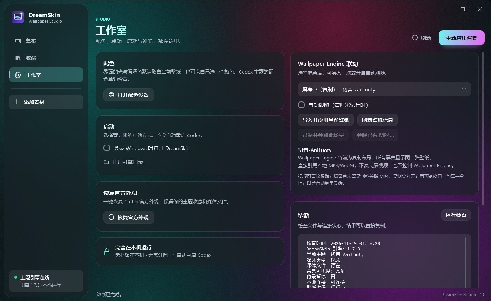

# DreamSkin Studio

[Codex Dream Skin](https://github.com/Fei-Away/Codex-Dream-Skin) 主题引擎的第三方管理界面，Windows 桌面程序（WPF）。它替换引擎自带的主题管理器，引擎本身和 Codex 程序都不改动。



## 功能

- 预览当前背景，调整背景透出度，暂停或恢复背景，一键恢复 Codex 官方外观。
- 主题收藏：搜索、预览、应用、重命名、移到回收站；导入图片、视频或主题 ZIP。
- 界面的光和强调色取自当前壁纸，在收藏里选中另一张主题时随之渐变；也可以手动指定颜色。
- 预览图放在 3D 平面上，会朝鼠标方向倾斜，带高光和倒影。窗口不在前台时所有动画暂停。
- Wallpaper Engine 联动：读取它保存的配置，导入某个屏幕当前的壁纸，或在管理器运行时自动跟随。支持“复制”布局。场景类壁纸可以先录成视频再关联。
- 连接诊断和操作记录。

## 运行条件

- Windows 10 或 11，64 位。
- 已安装 Codex Dream Skin 引擎。安装脚本只接受 1.7.3，其他版本没有验证过。
- 构建不需要 .NET SDK，用的是系统自带的 .NET Framework 4.8 编译器。

## 构建、自检、安装

```powershell
.\build.ps1                                        # 输出到 dist\
.\dist\DreamSkinStudio.exe --self-test .\dist\qa   # 只读自检，生成各页面截图和 report.json
.\dist\Install-New-Manager.ps1                     # 接入已安装的引擎
```

- 自检需要本机已有引擎和至少一个主题；它不会修改任何设置。
- 安装脚本会关闭正在运行的管理器，替换引擎目录里的管理器和后端脚本，校验文件哈希，并把原管理器备份到 `dist\rollback\`。
- 恢复原管理器：运行 `dist\Restore-Original-Manager.cmd`。壁纸、主题和透出度设置都保留。

## 目录

| 路径 | 内容 |
| --- | --- |
| `MainWindow.xaml` | 界面布局和控件样式 |
| `Studio.cs` | 程序入口、主窗口逻辑、只读自检 |
| `UiPalette.cs` | 配色：从壁纸或手选颜色推导整套界面颜色 |
| `Ambience.cs` | 壁纸取色、缩略图、极光背景和各种动效 |
| `ThemeColorDialog.cs` | 配色设置窗口 |
| `WallpaperLinkPanel.cs` | Wallpaper Engine 联动面板 |
| `backend\` | 管理器调用的 PowerShell 后端（主题操作、联动、场景录制） |
| `install\` | 安装和恢复脚本 |
| `assets\` | 图标，以及生成图标的 `make_icon.py` |
| `test_*.py` | 后端的隔离测试，使用临时目录，不触碰真实配置 |

## 已知限制

- 场景录制得到的是固定循环的视频，不会实时响应鼠标或音频。
- 动效需要支持硬件加速的显卡；远程会话或关闭了系统动画时，界面外观相同但保持静止。
- 后端脚本里有几处是按作者的机器写的，见下一节。

## 按作者机器写的部分

下面这些值是作者电脑上的实际位置，换一台电脑必须改，否则 Wallpaper Engine 联动和场景录制不能用。其余功能不受影响。代码里每一处都有 `MACHINE-SPECIFIC` 注释，搜索这个词可以全部找到。

| 文件 | 内容 | 当前值 |
| --- | --- | --- |
| `backend\wallpaper-link.ps1` | Wallpaper Engine 安装目录（参数 `-WallpaperEngineRoot` 的默认值） | `G:\steam\steamapps\common\wallpaper_engine` |
| `backend\record-wallpaper.ps1` | Wallpaper Engine 安装目录（`$wpeRoot`） | `G:\steam\steamapps\common\wallpaper_engine` |
| `backend\record-wallpaper.ps1` | ffmpeg 和 ffprobe 的位置（`$ffmpeg`、`$ffprobe`） | `G:\CodexMediaWork\Nijika-Cloud\tools\` |
| `backend\record-wallpaper.ps1` | 录制文件的输出目录（参数 `-OutputDirectory` 的默认值） | `G:\CodexMediaWork\SceneRecordings` |
| `backend\wallpaper-link.ps1` | 对创意工坊项目 `3650475846` 的兼容处理：作者早期录制过这个场景。本机没有对应的已保存主题时这段代码不起作用，可以不管。 | — |

管理器本身（`*.cs`、`MainWindow.xaml`）、安装脚本和测试不含写死的个人路径，状态目录取自 `%LOCALAPPDATA%\CodexDreamSkin`。

## 协议

本仓库的代码以 [MIT 协议](LICENSE) 发布。

本仓库只包含管理界面的源码，不包含 Codex Dream Skin 引擎的文件，也不包含任何壁纸素材。引擎由其作者另行以 MIT 协议发布。
