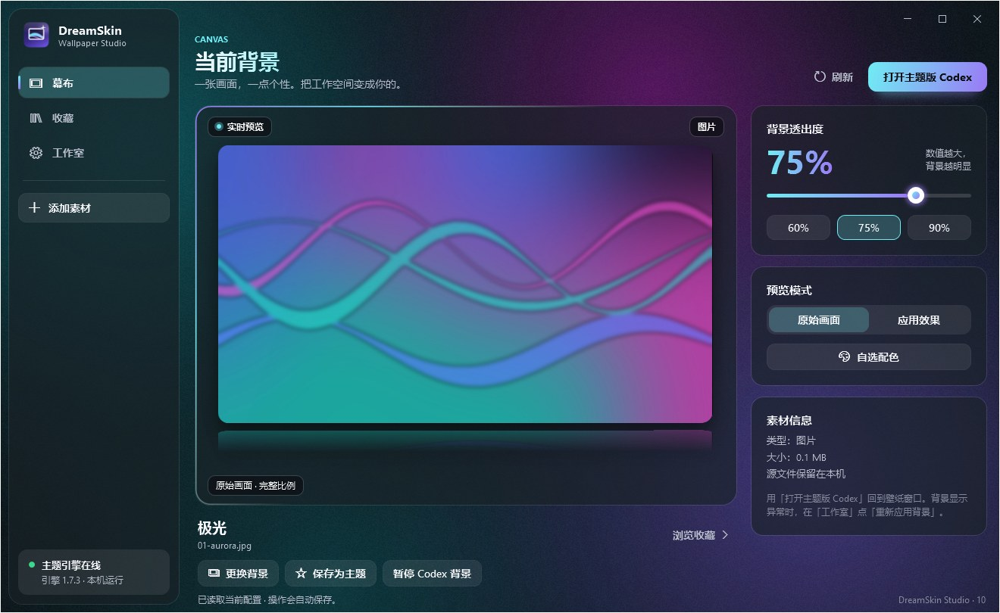
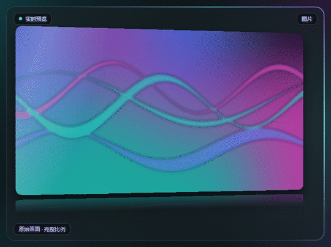
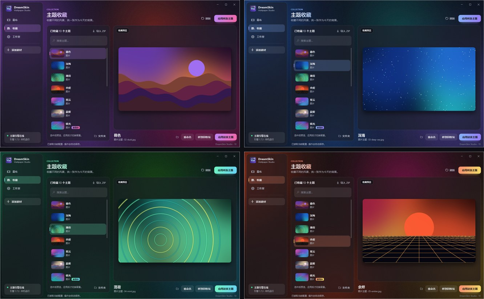
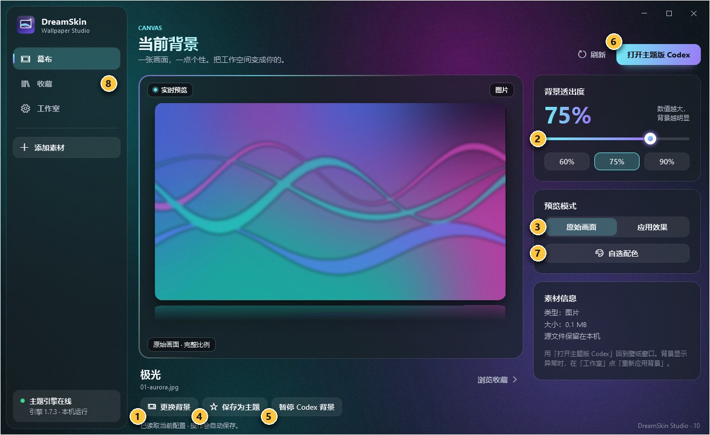
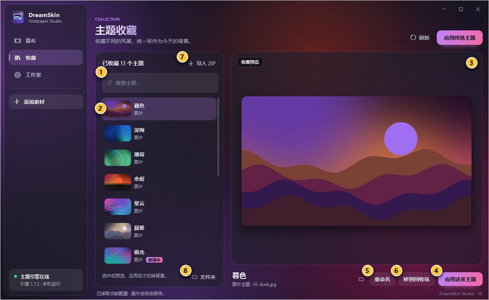
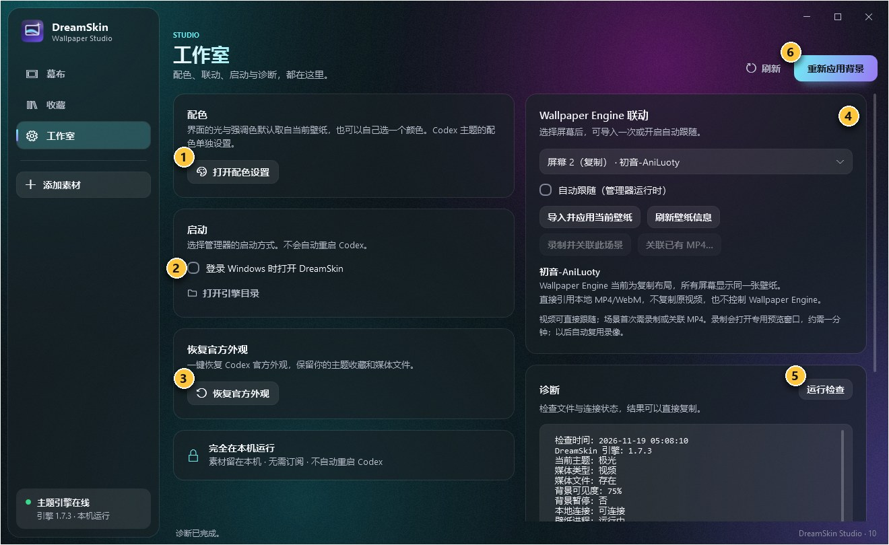
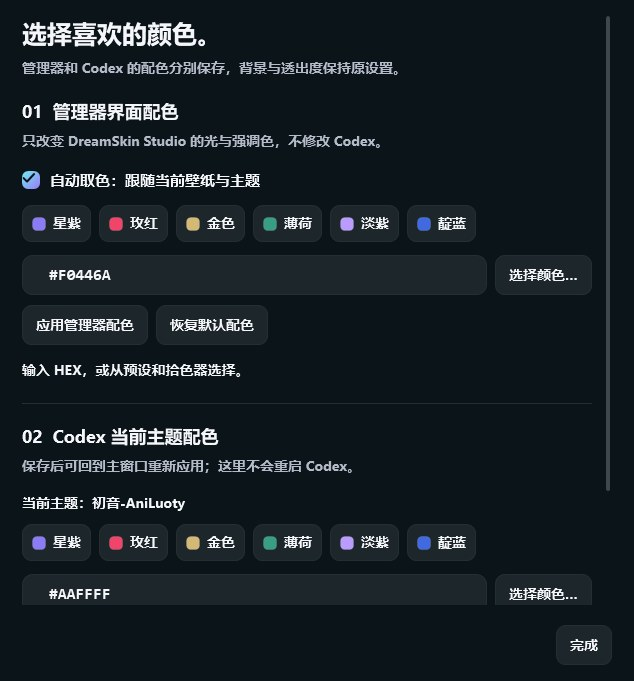

# DreamSkin Studio

[Codex Dream Skin](https://github.com/Fei-Away/Codex-Dream-Skin) 主题引擎的第三方管理界面，Windows 桌面程序（WPF）。它替换引擎自带的主题管理器，引擎本身和 Codex 程序都不改动。



## 功能

- 预览当前背景，调整背景透出度，暂停或恢复背景，一键恢复 Codex 官方外观。
- 主题收藏：搜索、预览、应用、重命名、移到回收站；导入图片、视频或主题 ZIP。
- Wallpaper Engine 联动：导入某个屏幕当前的壁纸，或在管理器运行时自动跟随。支持“复制”布局。场景类壁纸可以先录成视频再关联。
- 连接诊断和操作记录。

预览图放在 3D 平面上，会朝鼠标方向倾斜，带高光和倒影：



界面的光和强调色取自壁纸。在收藏里选中另一张主题，整个界面在一秒内渐变成它的色调（下图是同一个页面选中四张不同主题时的样子）：



## 运行条件

- Windows 10 或 11，64 位。
- 已安装 Codex 桌面版和 Codex Dream Skin 引擎。安装脚本只接受引擎 1.7.3，其他版本没有验证过。
- 构建不需要 .NET SDK，用的是系统自带的 .NET Framework 4.8 编译器。

## 操作步骤

### 第一步：准备

1. 按上游项目的说明安装 Codex Dream Skin 引擎，并至少成功应用过一次主题（在 Codex 里能看到背景）。
2. 取得本仓库的文件：

   ```powershell
   git clone https://github.com/TAMAONSEN/dreamskin-studio.git
   cd dreamskin-studio
   ```

   也可以在网页上点 Code → Download ZIP。用 ZIP 的话，解压前先右键 ZIP 文件 → 属性 → 勾选“解除锁定”，否则 Windows 会拒绝运行里面的脚本。

### 第二步：构建

在仓库文件夹里打开 PowerShell，运行：

```powershell
powershell -ExecutionPolicy RemoteSigned -File .\build.ps1
```

完成后会多出一个 `dist\` 文件夹，里面是 `DreamSkinStudio.exe`、后端脚本和安装脚本。

想先确认它在你的电脑上能正常工作，可以跑一次只读自检（不会修改任何设置）：

```powershell
.\dist\DreamSkinStudio.exe --self-test .\dist\qa
```

一分钟左右，`dist\qa\report.json` 里出现 `"ok":true` 就是通过，同一文件夹里还有各页面的截图。

### 第三步：安装

```powershell
powershell -ExecutionPolicy RemoteSigned -File .\dist\Install-New-Manager.ps1
```

脚本会依次：关闭正在运行的管理器，把原管理器备份到 `dist\rollback\`，替换引擎目录里的管理器和后端脚本并校验，最后打开新的管理器。

以后打开管理器的方式：

- 双击系统托盘里的「Codex 动态壁纸」图标。
- 桌面上的「Codex 动态壁纸」快捷方式，默认直接打开带背景的 Codex。想让它改为打开管理器，安装时加上 `-DesktopMode Manager`。

### 第四步：日常使用

#### 幕布：当前背景



1. **更换背景**：选一张图片或视频（PNG、JPG、WebP、MP4、WebM），导入后立即应用到 Codex。左侧的「添加素材」和快捷键 Ctrl+O 是同一个功能。
2. **背景透出度**：拖动滑块，或点 60%、75%、90%。数值越大背景越明显，松手后自动保存。
3. **预览模式**：「原始画面」显示素材本身，「应用效果」按当前透出度模拟它在 Codex 里的样子。
4. **保存为主题**：把当前背景连同配色和参数存进收藏。
5. **暂停 Codex 背景**：临时关掉背景，再点一次恢复。
6. **打开主题版 Codex**：打开或唤回带背景的 Codex 窗口，管理器自动最小化。
7. **自选配色**：打开配色窗口，见下文。
8. **导航**：切换到「收藏」和「工作室」。

按 F5 可以刷新状态。关闭管理器不会影响已经应用的背景。

#### 收藏：切换主题



1. **搜索**：按名称筛选。
2. **列表**：点一张主题。这时只是预览，当前背景不变。
3. **预览**：右侧显示选中的主题，界面配色随之变化。
4. **应用这张主题**：把选中的主题设为当前背景。右上角的「应用所选主题」作用相同。
5. **重命名**。
6. **移到回收站**：正在使用的主题不能移除，先应用别的主题。误删可以从 Windows 回收站恢复。
7. **导入 ZIP**：导入别人分享的主题包。导入后出现在列表里，选中再应用。
8. **文件夹**：打开保存主题的文件夹。

#### 工作室：设置与联动



1. **打开配色设置**：和幕布页的「自选配色」是同一个窗口。
2. **登录 Windows 时打开 DreamSkin**：默认不勾选。
3. **恢复官方外观**：去掉背景，让 Codex 回到原样。会先让你确认；收藏的主题和素材都保留。
4. **Wallpaper Engine 联动**：见下面的步骤。
5. **运行检查**：检查引擎文件和连接状态，结果可以直接复制。
6. **重新应用背景**：背景没有显示或显示不对时点这里。如果 Codex 窗口处于隐藏状态，应用会暂缓，把 Codex 切到前台后再点一次。

**把 Wallpaper Engine 的壁纸用到 Codex：**

1. 在下拉框里选择屏幕。Wallpaper Engine 使用“复制”布局时，各屏幕是同一张壁纸，条目后面会标注“（复制）”。
2. 视频类壁纸：点「导入并应用当前壁纸」。
3. 场景类壁纸：先点「录制并关联此场景」，它会打开一个专用的预览窗口录制约一分钟；或者点「关联已有 MP4…」选一个已有的录像。完成后再点「导入并应用当前壁纸」。
4. 想让 Codex 跟着 Wallpaper Engine 换壁纸，勾选「自动跟随」。管理器开着的时候每 8 秒检查一次，关掉管理器就停止。

联动和录制用到的几个路径是按作者的电脑写的，使用前请看[按作者机器写的部分](#按作者机器写的部分)。

#### 配色窗口



- **上半部分是管理器自己的颜色**。勾选「自动取色」时跟随当前壁纸；取消勾选后，点一个预设色、输入 HEX 或用「选择颜色…」，再点「应用管理器配色」。
- **下半部分是 Codex 当前主题的颜色**。改强调色，或展开「高级」改背景、面板和文字色，点「保存 Codex 配色」，然后回主窗口点「重新应用背景」生效。「恢复主题原配色」可以撤销。

### 恢复原来的管理器

运行 `dist\Restore-Original-Manager.cmd`。壁纸、主题和透出度设置都保留。

## 目录

| 路径 | 内容 |
| --- | --- |
| `MainWindow.xaml` | 界面布局和控件样式 |
| `Studio.cs` | 程序入口、主窗口逻辑、只读自检 |
| `UiPalette.cs` | 配色：从壁纸或手选颜色推导整套界面颜色 |
| `Ambience.cs` | 壁纸取色、缩略图、极光背景和各种动效 |
| `ThemeColorDialog.cs` | 配色设置窗口 |
| `WallpaperLinkPanel.cs` | Wallpaper Engine 联动面板 |
| `backend\` | 管理器调用的 PowerShell 后端（主题操作、联动、场景录制） |
| `install\` | 安装和恢复脚本 |
| `assets\` | 图标，以及生成图标的 `make_icon.py` |
| `docs\` | 本页的图片，以及生成它们的两个脚本 |
| `test_*.py` | 后端的隔离测试，使用临时目录，不触碰真实配置 |

## 关于本页的截图

截图里的壁纸和主题名称是专门为文档生成的示例，不是任何人的收藏。重新生成的方法（需要 Python 和 Pillow）：

```powershell
python docs\make_sample_art.py $env:TEMP\dss-samples
.\dist\DreamSkinStudio.exe --self-test .\dist\qa $env:TEMP\dss-samples
python docs\make_readme_images.py .\dist\qa docs
```

自检带上第三个参数时，会用那个文件夹里的图片代替本机收藏里的壁纸来显示，并按图片取色。它同样是只读的。

## 已知限制

- 场景录制得到的是固定循环的视频，不会实时响应鼠标或音频。
- 动效需要支持硬件加速的显卡；远程会话或关闭了系统动画时，界面外观相同但保持静止。
- 后端脚本里有几处是按作者的机器写的，见下一节。

## 按作者机器写的部分

下面这些值是作者电脑上的实际位置，换一台电脑必须改，否则 Wallpaper Engine 联动和场景录制不能用。其余功能不受影响。代码里每一处都有 `MACHINE-SPECIFIC` 注释，搜索这个词可以全部找到。

| 文件 | 内容 | 当前值 |
| --- | --- | --- |
| `backend\wallpaper-link.ps1` | Wallpaper Engine 安装目录（参数 `-WallpaperEngineRoot` 的默认值） | `G:\steam\steamapps\common\wallpaper_engine` |
| `backend\record-wallpaper.ps1` | Wallpaper Engine 安装目录（`$wpeRoot`） | `G:\steam\steamapps\common\wallpaper_engine` |
| `backend\record-wallpaper.ps1` | ffmpeg 和 ffprobe 的位置（`$ffmpeg`、`$ffprobe`） | `G:\CodexMediaWork\Nijika-Cloud\tools\` |
| `backend\record-wallpaper.ps1` | 录制文件的输出目录（参数 `-OutputDirectory` 的默认值） | `G:\CodexMediaWork\SceneRecordings` |
| `backend\wallpaper-link.ps1` | 对创意工坊项目 `3650475846` 的兼容处理：作者早期录制过这个场景。本机没有对应的已保存主题时这段代码不起作用，可以不管。 | — |

改完这些路径后需要重新构建并安装，改动才会进入引擎目录。

管理器本身（`*.cs`、`MainWindow.xaml`）、安装脚本和测试不含写死的个人路径，状态目录取自 `%LOCALAPPDATA%\CodexDreamSkin`。

## 协议

本仓库的代码以 [MIT 协议](LICENSE) 发布。

本仓库只包含管理界面的源码，不包含 Codex Dream Skin 引擎的文件，也不包含任何壁纸素材。引擎由其作者另行以 MIT 协议发布。
